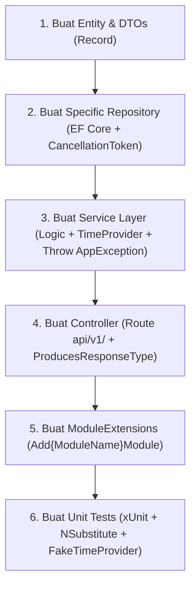

# .NET 10 Modular API Design

Panduan dan instruksi perancangan, pembuatan (scaffolding), serta refactoring RESTful API pada **.NET 10 (C# 14)** dengan arsitektur **Modular Monolith**.

---

## 1. When to Use This Skill

### ✅ Trigger Aktivasi (Gunakan skill ini jika):
- Pengguna meminta membuat API baru atau melakukan scaffolding modul baru (contoh: *"Buatkan modul Products/Orders"*).
- Pengguna meminta standarisasi arsitektur: controller, service, repository, DTO, atau error handling.
- Review dan refactoring kode backend .NET agar sesuai standar modular monolith enterprise.

### ❌ Batasan (Jangan gunakan skill ini jika):
- Aplikasi berbasis Console atau Worker Service murni tanpa HTTP pipeline.
- Arsitektur Microservices terdistribusi dengan event bus eksternal (Kafka/RabbitMQ).
- Minimal API sederhana tanpa layer arsitektur (gunakan skill minimal API terkait).

---

## 2. Core Guardrails (Aturan Mutlak AI)

Saat menulis atau memodifikasi kode, agen AI **WAJIB** mematuhi 7 aturan mutlak ini:

1. **Wajib CancellationToken**: Setiap method async di Controller, Service, dan Repository **harus** menerima dan meneruskan parameter `CancellationToken cancellationToken = default`.
2. **Wajib Standar Envelope**: Semua endpoint Controller **harus** mengembalikan `ApiResponse<T>` atau `ApiResponse`. Dilarang me-return raw entity atau object tanpa envelope.
3. **Wajib Explicit Versioning**: Route Controller **harus** menggunakan format eksplisit: `[Route("api/v1/[controller]")]`.
4. **Dilarang Generic Repository**: Buat interface repository spesifik per modul (misal: `IEmployeeRepository`). Dilarang membuat `IRepository<T>` atau `GenericRepository<T>`.
5. **Dilarang In-Memory Join**: Operasi JOIN antar-tabel wajib diselesaikan di database level. Operasi read wajib menggunakan `.AsNoTracking()`.
6. **Modern C# 14 Idioms**: Wajib gunakan **Primary Constructors** pada class, **Collection Expressions (`[..]`)**, dan abstraksi **`TimeProvider`** (bukan `DateTime.UtcNow` statis).
7. **Centralized Error Handling**: Service layer melempar (`throw`) turunan `AppException`. Dilarang menangkap exception manual dengan `try-catch` di Controller; biarkan `GlobalExceptionHandler` (`IExceptionHandler`) yang menanganinya.

---

## 3. Struktur Folder Modular Monolith

Setiap modul berdiri sendiri secara vertikal (*vertical slice*) di dalam folder `Modules/{ModuleName}`:

```text
MyService.Api/
├── Modules/
│   ├── Employees/
│   │   ├── Controllers/EmployeesController.cs       # Versioned Route + CancellationToken
│   │   ├── Services/IEmployeeService.cs, EmployeeService.cs # Business logic + TimeProvider
│   │   ├── Repositories/IEmployeeRepository.cs, EmployeeRepository.cs # Specific Repository
│   │   ├── Dtos/CreateEmployeeRequest.cs, EmployeeResponse.cs # Positional Records
│   │   ├── Entities/Employee.cs                     # Domain Entity
│   │   ├── Validators/CreateEmployeeRequestValidator.cs # FluentValidation
│   │   └── EmployeesModuleExtensions.cs             # DI Service Registration
│   └── {NextModule}/
├── Common/
│   ├── Errors/ErrorCode.cs, ErrorCodeExtensions.cs  # FrozenDictionary Error Map
│   ├── Exceptions/AppException.cs, NotFoundException.cs, ConflictException.cs
│   ├── Handlers/GlobalExceptionHandler.cs          # IExceptionHandler .NET 10
│   └── Models/ApiResponse.cs, PagedResult.cs
├── Data/AppDbContext.cs
└── Program.cs                                       # Native OpenAPI + Pipeline
```

---

## 4. Standar Fondasi Sistem (Common Layer)

Fondasi ini digunakan secara bersama oleh semua modul. Buat/pastikan file ini tersedia:

### A. Envelope Response (`Common/Models/ApiResponse.cs`)
```csharp
namespace MyService.Api.Common.Models;

public class ApiResponse<T>
{
    public bool Success { get; init; }
    public string Code { get; init; } = string.Empty;
    public string Message { get; init; } = string.Empty;
    public T? Data { get; init; }
    public object? Errors { get; init; }
    public DateTimeOffset Timestamp { get; init; } = DateTimeOffset.UtcNow;

    public static ApiResponse<T> SuccessResult(T data, string message = "Permintaan berhasil diproses.") =>
        new() { Success = true, Code = "SUCCESS", Message = message, Data = data };

    public static ApiResponse<T> FailureResult(string code, string message, object? errors = null) =>
        new() { Success = false, Code = code, Message = message, Errors = errors };
}

public class ApiResponse : ApiResponse<object>
{
    public static ApiResponse SuccessResult(string message = "Permintaan berhasil diproses.") =>
        new() { Success = true, Code = "SUCCESS", Message = message };

    public static new ApiResponse FailureResult(string code, string message, object? errors = null) =>
        new() { Success = false, Code = code, Message = message, Errors = errors };
}
```

### B. ErrorCode & Extensions (`Common/Errors/`)
```csharp
// Common/Errors/ErrorCode.cs
namespace MyService.Api.Common.Errors;

public enum ErrorCode
{
    None = 0,
    InternalServerError = 1000,
    ValidationError = 1001,
    UnauthorizedAccess = 1002,
    ForbiddenAccess = 1003,
    BadRequest = 1004,
    OperationCancelled = 1005,
    
    // Domain Errors: 2000+
    EntityNotFound = 2000,
    EntityAlreadyExists = 2001,
    InvalidBusinessRule = 2002
}
```

```csharp
// Common/Errors/ErrorCodeExtensions.cs
using System.Collections.Frozen;
using System.Net;

namespace MyService.Api.Common.Errors;

public static class ErrorCodeExtensions
{
    private static readonly IReadOnlyDictionary<ErrorCode, (HttpStatusCode StatusCode, string Message)> ErrorMap =
        new Dictionary<ErrorCode, (HttpStatusCode StatusCode, string Message)>
        {
            [ErrorCode.None] = (HttpStatusCode.OK, "Success."),
            [ErrorCode.InternalServerError] = (HttpStatusCode.InternalServerError, "Terjadi kesalahan internal pada server."),
            [ErrorCode.ValidationError] = (HttpStatusCode.BadRequest, "Satu atau lebih data masukan tidak valid."),
            [ErrorCode.UnauthorizedAccess] = (HttpStatusCode.Unauthorized, "Autentikasi diperlukan."),
            [ErrorCode.ForbiddenAccess] = (HttpStatusCode.Forbidden, "Hak akses ditolak."),
            [ErrorCode.BadRequest] = (HttpStatusCode.BadRequest, "Format permintaan tidak valid."),
            [ErrorCode.OperationCancelled] = ((HttpStatusCode)499, "Permintaan dibatalkan oleh pengguna atau timeout."),
            [ErrorCode.EntityNotFound] = (HttpStatusCode.NotFound, "Data yang diminta tidak ditemukan."),
            [ErrorCode.EntityAlreadyExists] = (HttpStatusCode.Conflict, "Data sudah terdaftar di sistem."),
            [ErrorCode.InvalidBusinessRule] = (HttpStatusCode.BadRequest, "Aturan bisnis tidak terpenuhi.")
        }.ToFrozenDictionary();

    public static HttpStatusCode ToHttpStatusCode(this ErrorCode code) =>
        ErrorMap.TryGetValue(code, out var item) ? item.StatusCode : HttpStatusCode.InternalServerError;

    public static string ToDefaultMessage(this ErrorCode code) =>
        ErrorMap.TryGetValue(code, out var item) ? item.Message : "Terjadi kesalahan tidak terduga.";

    public static string ToErrorCodeString(this ErrorCode code) =>
        code == ErrorCode.None ? "SUCCESS" : $"ERR_{code.ToString().ToUpperInvariant()}";
}
```

### C. Domain Exceptions (`Common/Exceptions/AppException.cs`)
```csharp
using System.Net;
using MyService.Api.Common.Errors;

namespace MyService.Api.Common.Exceptions;

public class AppException(ErrorCode errorCode, string? message = null, object? errors = null, HttpStatusCode? statusCode = null) 
    : Exception(message ?? errorCode.ToDefaultMessage())
{
    public ErrorCode ErrorCode { get; } = errorCode;
    public HttpStatusCode StatusCode { get; } = statusCode ?? errorCode.ToHttpStatusCode();
    public object? Errors { get; } = errors;
}

public class NotFoundException(ErrorCode errorCode, string? message = null) 
    : AppException(errorCode, message, null, HttpStatusCode.NotFound);

public class ConflictException(ErrorCode errorCode, string? message = null) 
    : AppException(errorCode, message, null, HttpStatusCode.Conflict);

public class ValidationException(object errors, string message = "Validasi data gagal.") 
    : AppException(ErrorCode.ValidationError, message, errors, HttpStatusCode.BadRequest);
```

### D. Centralized Exception Handler (`Common/Handlers/GlobalExceptionHandler.cs`)
```csharp
using System.Net;
using Microsoft.AspNetCore.Diagnostics;
using MyService.Api.Common.Errors;
using MyService.Api.Common.Exceptions;
using MyService.Api.Common.Models;

namespace MyService.Api.Common.Handlers;

public class GlobalExceptionHandler(ILogger<GlobalExceptionHandler> logger) : IExceptionHandler
{
    public async ValueTask<bool> TryHandleAsync(HttpContext context, Exception exception, CancellationToken cancellationToken)
    {
        var (statusCode, code, message, errors) = exception switch
        {
            OperationCanceledException => (
                (HttpStatusCode)499, 
                ErrorCode.OperationCancelled.ToErrorCodeString(), 
                ErrorCode.OperationCancelled.ToDefaultMessage(), 
                (object?)null),
            AppException appEx => (
                appEx.StatusCode, 
                appEx.ErrorCode.ToErrorCodeString(), 
                appEx.Message, 
                appEx.Errors),
            _ => (
                HttpStatusCode.InternalServerError, 
                ErrorCode.InternalServerError.ToErrorCodeString(), 
                ErrorCode.InternalServerError.ToDefaultMessage(), 
                (object?)null)
        };

        if (statusCode == HttpStatusCode.InternalServerError)
            logger.LogError(exception, "Unhandled error: {Path}", context.Request.Path);
        else
            logger.LogWarning("Domain error ({Code}): {Message}", code, message);

        context.Response.StatusCode = (int)statusCode;
        context.Response.ContentType = "application/json";
        await context.Response.WriteAsJsonAsync(ApiResponse.FailureResult(code, message, errors), cancellationToken);
        return true;
    }
}
```

---

## 5. Step-by-Step Execution Workflow (Scaffolding Modul)

Ketika pengguna meminta membuat modul baru `{ModuleName}` (misal: `Employees`), ikuti langkah-langkah terurut berikut:



### Step 1: Buat Entitas & DTOs
- Gunakan positional `record` untuk Request dan Response DTO (bersifat immutable).
- Gunakan `DateTimeOffset` untuk timestamp field.

### Step 2: Buat Specific Repository
- Wajib sertakan `CancellationToken cancellationToken = default` pada setiap method.
- Gunakan `.AsNoTracking()` pada semua operasi read.
- Gunakan primary constructor: `public class {ModuleName}Repository(AppDbContext context) : I{ModuleName}Repository`.
- Konsultasikan [Database Performance Guide](./references/database-performance.md) untuk query berelasi, pencegahan N+1, dan paginasi.

### Step 3: Buat Service Layer
- Suntikkan dependency via primary constructor: `(I{ModuleName}Repository repository, ILogger<{ModuleName}Service> logger, TimeProvider timeProvider)`.
- Validasi aturan bisnis. Jika tidak valid, lempar `NotFoundException`, `ConflictException`, atau `AppException`.
- Gunakan Collection Expressions `[.. list.Select(MapToResponse)]`.

### Step 4: Buat Controller
- Sematkan atribut `[ApiController]`, `[Route("api/v1/[controller]")]`, dan `[Produces("application/json")]`.
- Sematkan `[ProducesResponseType]` untuk setiap status code yang relevan.
- Selalu terima `CancellationToken cancellationToken` dari parameter aksi controller dan teruskan ke service.

### Step 5: Buat Extension Method DI
- Buat file `{ModuleName}ModuleExtensions.cs` yang mendaftarkan Repository dan Service dengan `AddScoped`.
- Panggil di `Program.cs`: `builder.Services.Add{ModuleName}Module(builder.Configuration);`.

### Step 6: Buat Unit Tests
- Tulis unit test di folder `Tests/Modules/{ModuleName}/`.
- Uji skenario **Happy Path**, **Negative/Exception Path**, dan verifikasi propagasi **CancellationToken**.

---

## 6. Golden Scaffolding Template (Contoh Modul: Employees)

Gunakan pola kode berikut sebagai cetak biru implementasi:

```csharp
// 1. DTOs (Modules/Employees/Dtos/EmployeeDtos.cs)
namespace MyService.Api.Modules.Employees.Dtos;

public record CreateEmployeeRequest(string FirstName, string LastName, string Email, string Position, decimal Salary, Guid DepartmentId);
public record UpdateEmployeeRequest(string FirstName, string LastName, string Position, decimal Salary, Guid DepartmentId);
public record EmployeeResponse(Guid Id, string FullName, string Email, string Position, decimal Salary, Guid DepartmentId, bool IsActive, DateTimeOffset CreatedAt);

// 2. Repository Interface & Impl (Modules/Employees/Repositories/)
public interface IEmployeeRepository
{
    Task<IReadOnlyList<Employee>> GetAllAsync(CancellationToken cancellationToken = default);
    Task<Employee?> GetByIdAsync(Guid id, CancellationToken cancellationToken = default);
    Task<bool> ExistsByEmailAsync(string email, Guid? excludeId = null, CancellationToken cancellationToken = default);
    Task AddAsync(Employee employee, CancellationToken cancellationToken = default);
    Task UpdateAsync(Employee employee, CancellationToken cancellationToken = default);
    Task<int> SaveChangesAsync(CancellationToken cancellationToken = default);
}

public class EmployeeRepository(AppDbContext context) : IEmployeeRepository
{
    public async Task<IReadOnlyList<Employee>> GetAllAsync(CancellationToken cancellationToken = default) =>
        await context.Set<Employee>().AsNoTracking().Where(e => e.IsActive).OrderByDescending(e => e.CreatedAt).ToListAsync(cancellationToken);

    public async Task<Employee?> GetByIdAsync(Guid id, CancellationToken cancellationToken = default) =>
        await context.Set<Employee>().FirstOrDefaultAsync(e => e.Id == id && e.IsActive, cancellationToken);

    public async Task<bool> ExistsByEmailAsync(string email, Guid? excludeId = null, CancellationToken cancellationToken = default)
    {
        var query = context.Set<Employee>().AsNoTracking();
        if (excludeId.HasValue) query = query.Where(e => e.Id != excludeId.Value);
        return await query.AnyAsync(e => e.Email.ToLower() == email.ToLower(), cancellationToken);
    }

    public async Task AddAsync(Employee employee, CancellationToken cancellationToken = default) =>
        await context.Set<Employee>().AddAsync(employee, cancellationToken);

    public Task UpdateAsync(Employee employee, CancellationToken cancellationToken = default)
    {
        context.Set<Employee>().Update(employee);
        return Task.CompletedTask;
    }

    public async Task<int> SaveChangesAsync(CancellationToken cancellationToken = default) =>
        await context.SaveChangesAsync(cancellationToken);
}

// 3. Service Layer (Modules/Employees/Services/)
public interface IEmployeeService
{
    Task<IReadOnlyList<EmployeeResponse>> GetAllAsync(CancellationToken cancellationToken = default);
    Task<EmployeeResponse> GetByIdAsync(Guid id, CancellationToken cancellationToken = default);
    Task<EmployeeResponse> CreateAsync(CreateEmployeeRequest request, CancellationToken cancellationToken = default);
    Task DeleteAsync(Guid id, CancellationToken cancellationToken = default);
}

public class EmployeeService(
    IEmployeeRepository repository, 
    ILogger<EmployeeService> logger, 
    TimeProvider timeProvider) : IEmployeeService
{
    public async Task<IReadOnlyList<EmployeeResponse>> GetAllAsync(CancellationToken cancellationToken = default)
    {
        var items = await repository.GetAllAsync(cancellationToken);
        return [.. items.Select(MapToResponse)];
    }

    public async Task<EmployeeResponse> GetByIdAsync(Guid id, CancellationToken cancellationToken = default)
    {
        var item = await repository.GetByIdAsync(id, cancellationToken)
            ?? throw new NotFoundException(ErrorCode.EntityNotFound, $"Karyawan dengan ID '{id}' tidak ditemukan.");
        return MapToResponse(item);
    }

    public async Task<EmployeeResponse> CreateAsync(CreateEmployeeRequest request, CancellationToken cancellationToken = default)
    {
        if (request.Salary <= 0)
            throw new AppException(ErrorCode.InvalidBusinessRule, "Gaji karyawan harus lebih besar dari 0.");

        if (await repository.ExistsByEmailAsync(request.Email, null, cancellationToken))
            throw new ConflictException(ErrorCode.EntityAlreadyExists, $"Email '{request.Email}' sudah terdaftar.");

        var employee = new Employee
        {
            FirstName = request.FirstName.Trim(),
            LastName = request.LastName.Trim(),
            Email = request.Email.Trim().ToLower(),
            Position = request.Position.Trim(),
            Salary = request.Salary,
            DepartmentId = request.DepartmentId,
            CreatedAt = timeProvider.GetUtcNow()
        };

        await repository.AddAsync(employee, cancellationToken);
        await repository.SaveChangesAsync(cancellationToken);
        logger.LogInformation("Employee created: {Id}", employee.Id);

        return MapToResponse(employee);
    }

    public async Task DeleteAsync(Guid id, CancellationToken cancellationToken = default)
    {
        var employee = await repository.GetByIdAsync(id, cancellationToken)
            ?? throw new NotFoundException(ErrorCode.EntityNotFound, $"Karyawan dengan ID '{id}' tidak ditemukan.");

        employee.IsActive = false;
        employee.UpdatedAt = timeProvider.GetUtcNow();
        await repository.UpdateAsync(employee, cancellationToken);
        await repository.SaveChangesAsync(cancellationToken);
    }

    private static EmployeeResponse MapToResponse(Employee e) =>
        new(e.Id, $"{e.FirstName} {e.LastName}".Trim(), e.Email, e.Position, e.Salary, e.DepartmentId, e.IsActive, e.CreatedAt);
}

// 4. Controller (Modules/Employees/Controllers/EmployeesController.cs)
[ApiController]
[Route("api/v1/[controller]")]
[Produces("application/json")]
public class EmployeesController(IEmployeeService employeeService) : ControllerBase
{
    [HttpGet]
    [ProducesResponseType(typeof(ApiResponse<IReadOnlyList<EmployeeResponse>>), StatusCodes.Status200OK)]
    public async Task<IActionResult> GetAll(CancellationToken cancellationToken)
    {
        var result = await employeeService.GetAllAsync(cancellationToken);
        return Ok(ApiResponse<IReadOnlyList<EmployeeResponse>>.SuccessResult(result));
    }

    [HttpGet("{id:guid}")]
    [ProducesResponseType(typeof(ApiResponse<EmployeeResponse>), StatusCodes.Status200OK)]
    [ProducesResponseType(typeof(ApiResponse), StatusCodes.Status404NotFound)]
    public async Task<IActionResult> GetById([FromRoute] Guid id, CancellationToken cancellationToken)
    {
        var result = await employeeService.GetByIdAsync(id, cancellationToken);
        return Ok(ApiResponse<EmployeeResponse>.SuccessResult(result));
    }

    [HttpPost]
    [ProducesResponseType(typeof(ApiResponse<EmployeeResponse>), StatusCodes.Status201Created)]
    [ProducesResponseType(typeof(ApiResponse), StatusCodes.Status400BadRequest)]
    [ProducesResponseType(typeof(ApiResponse), StatusCodes.Status409Conflict)]
    public async Task<IActionResult> Create([FromBody] CreateEmployeeRequest request, CancellationToken cancellationToken)
    {
        var result = await employeeService.CreateAsync(request, cancellationToken);
        return CreatedAtAction(nameof(GetById), new { id = result.Id }, ApiResponse<EmployeeResponse>.SuccessResult(result, "Karyawan berhasil dibuat."));
    }
}

// 5. Dependency Injection Registration (Modules/Employees/EmployeesModuleExtensions.cs)
public static class EmployeesModuleExtensions
{
    public static IServiceCollection AddEmployeesModule(this IServiceCollection services, IConfiguration configuration)
    {
        services.AddScoped<IEmployeeRepository, EmployeeRepository>();
        services.AddScoped<IEmployeeService, EmployeeService>();
        return services;
    }
}
```

---

## 7. Pipeline Program.cs (.NET 10)

```csharp
using Microsoft.EntityFrameworkCore;
using MyService.Api.Common.Handlers;
using MyService.Api.Data;
using MyService.Api.Modules.Employees;
using Scalar.AspNetCore;

var builder = WebApplication.CreateBuilder(args);

// Database & TimeProvider
builder.Services.AddDbContext<AppDbContext>(opt => 
    opt.UseSqlServer(builder.Configuration.GetConnectionString("DefaultConnection")));
builder.Services.AddSingleton(TimeProvider.System);

// Centralized Exception Handling (.NET 10)
builder.Services.AddExceptionHandler<GlobalExceptionHandler>();
builder.Services.AddProblemDetails();

builder.Services.AddControllers();

// Modul DI
builder.Services.AddEmployeesModule(builder.Configuration);

// Native OpenAPI (.NET 10)
builder.Services.AddOpenApi("v1");
builder.Services.AddHealthChecks().AddDbContextCheck<AppDbContext>("database");

var app = builder.Build();

app.UseExceptionHandler(); // Wajib paling awal

if (app.Environment.IsDevelopment())
{
    app.MapOpenApi();
    app.MapScalarApiReference();
}

app.UseHttpsRedirection();
app.UseRouting();
app.UseAuthentication();
app.UseAuthorization();

app.MapControllers();
app.MapHealthChecks("/health");

app.Run();
```

---

## 8. Definition of Done & Verification

Sebelum menyatakan tugas pembuatan API selesai, agen AI wajib memverifikasi:

1. **Build Check**: Jalankan build dan pastikan 0 error dan 0 warning:
   ```bash
   dotnet build --configuration Release
   ```
2. **Contract Compliance**:
   - [ ] Semua endpoint memiliki prefix `api/v1/`.
   - [ ] Semua method async memiliki parameter `CancellationToken`.
   - [ ] Semua response menggunakan wrapper `ApiResponse<T>`.
   - [ ] Tidak ada entity EF Core yang terekspos langsung ke controller (wajib via DTO).
3. **Database Performance Check**:
   - [ ] Tidak ada query di dalam loop (`N+1`).
   - [ ] Semua query read menggunakan `.AsNoTracking()`.
   - [ ] Pengecekan data menggunakan `.AnyAsync()`.
4. **Unit Test Pass**: Jalankan pengujian dan pastikan lolos 100%:
   ```bash
   dotnet test
   ```

---

## 9. References & Deep-Dives

Untuk implementasi database yang kompleks, baca dokumen referensi terkait:
- 📄 [Database Performance Best Practices (N+1, Dapper, AsSplitQuery, Bulk Operations)](./references/database-performance.md)
- 📄 [Entity Framework Core Design Patterns & Architecture](../efcore-pattern/SKILL.md)
